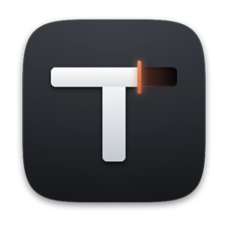
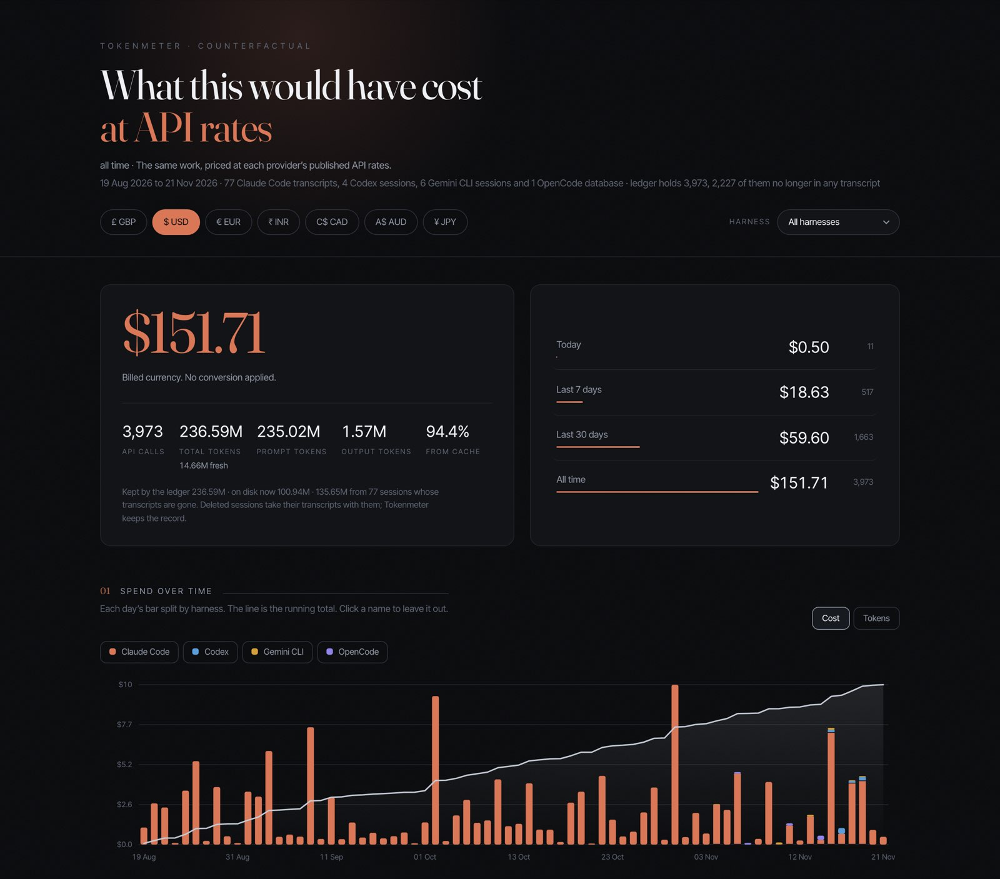
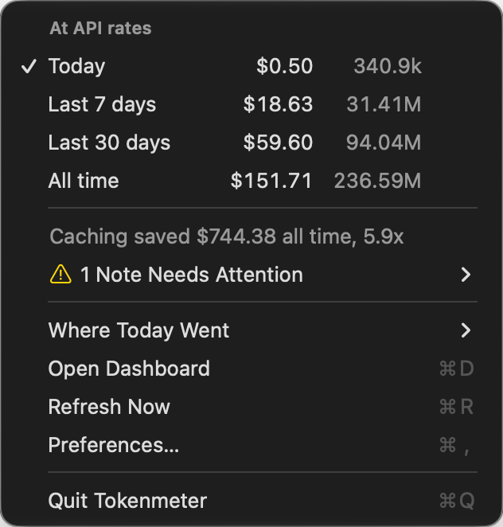
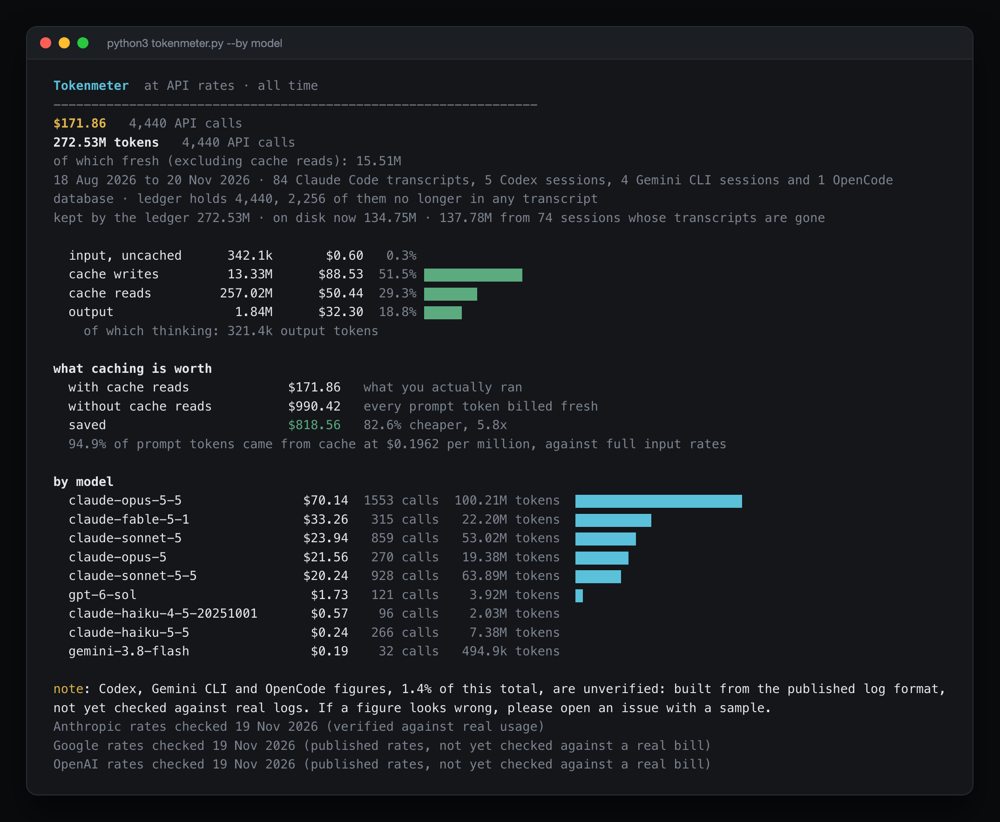
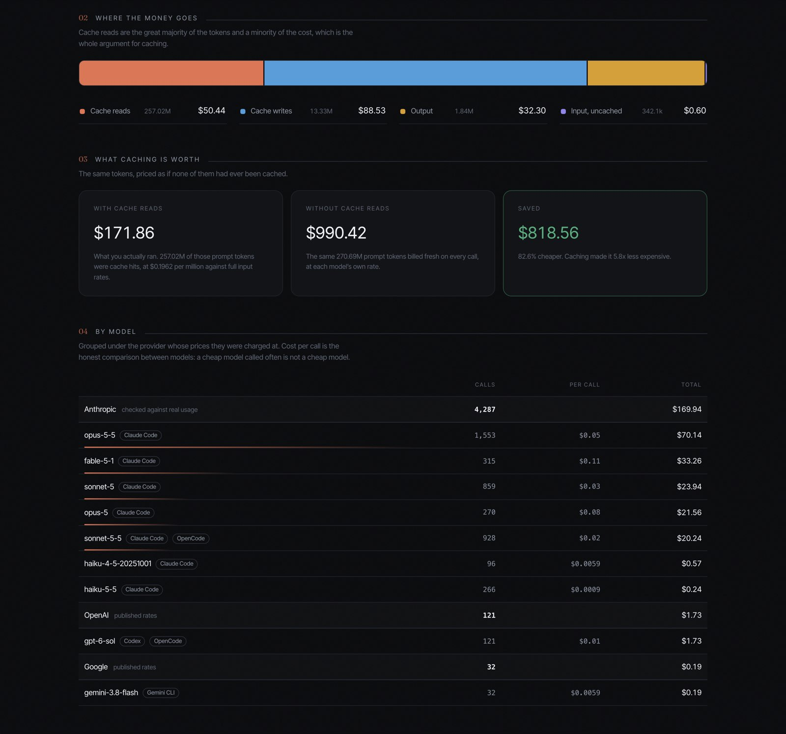
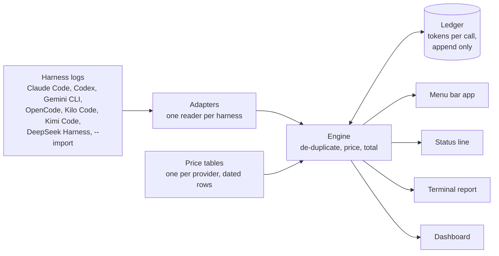
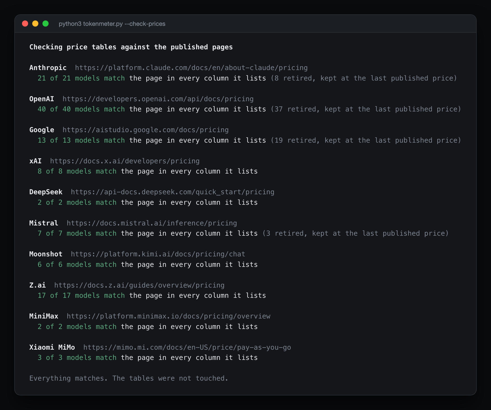

# Tokenmeter

**What your AI coding would have cost at API rates.**

[](https://github.com/Adi-debug-source/tokenmeter/actions/workflows/test.yml)
[](https://github.com/Adi-debug-source/tokenmeter/releases/latest)
[](LICENSE)

On a subscription, a coding agent's usage is not billed per token, so you never see what it would cost. Tokenmeter reads the logs your harness already writes on your Mac and prices every API call at the provider's published rates. It is a counterfactual, not a bill, and nothing about your usage leaves the machine.



The images in this README show an invented history, made by [`docs/screenshots/make_demo.py`](docs/screenshots/make_demo.py), not anyone's real usage. The menu bar image is the real app running against that demo; it is taller than one screen, so it ends at Show tokens. The status line below is the real script's output for one of the demo's sessions.

## Install

```bash
git clone https://github.com/Adi-debug-source/tokenmeter.git
./tokenmeter/install.sh
```

Or with [Homebrew](https://brew.sh):

```bash
brew tap adi-debug-source/tokenmeter https://github.com/Adi-debug-source/tokenmeter
brew install adi-debug-source/tokenmeter/tokenmeter
tokenmeter-setup
```

Either way the same installer runs. It copies the engine to `~/.claude/tools/tokenmeter/`, builds the menu bar app into `~/Applications`, sets it to start at login, and, if you use Claude Code, adds the `/tokenmeter` command and the status line. If you already have a status line it is left alone; add `--statusline` to replace it, or `--no-app` to skip the menu bar app.

It needs macOS 12 or later, Python 3.9 or later with no packages to install, and, for the menu bar app, the Xcode command line tools (`xcode-select --install`; Homebrew installs them for you). The menu bar app runs `/usr/bin/python3`, which those tools provide (3.9.6 in current versions).

- **Updating.** Inside the clone, `git pull` and run `./install.sh` again. With Homebrew, `brew upgrade tokenmeter` and run `tokenmeter-setup` again: the formula lives in this repository, and Homebrew cannot write to your home folder itself, which is why setup is a separate step.
- **Removing.** `./install.sh --uninstall` inside the clone, or `tokenmeter-setup --uninstall` then `brew uninstall tokenmeter`. Your usage history is kept. Files are moved to the Bin rather than deleted, except the login item's generated plist, which is removed.

## What you get

One engine works everything out, and four faces show it.

### The menu bar app



The running figure, always visible, refreshed every minute: today, the last 7 days, the last 30 and all time, then where it went by model, harness or provider. Show tokens puts each window's tokens beside its cost, and the Currency menu switches between seven currencies.

### The Claude Code status line and `/tokenmeter`

```text
Opus 5.5 │ ctx  11% │ $1.98 session │ $3.08 today
███░░░░░░░░░░░░░░░░░░░░░░░░░░░ 112.8k / 1M · would-be API spend
```

Under every prompt: this session's cost, its agents included, today's cost across every project, and how full the context window is, as Claude Code reports it. Inside a conversation, `/tokenmeter` gives any report.

### The terminal report



With Homebrew the `tokenmeter` command is already there. From a clone, make it with:

```bash
alias tokenmeter="python3 ~/.claude/tools/tokenmeter/tokenmeter.py"
```

```bash
tokenmeter                      # everything found, all time
tokenmeter --by model           # or project, day, week, month, session, hour, weekday, source, provider
tokenmeter --since 30d          # a rolling window: 24h, 7d, 30d, 2026-09-01
tokenmeter --period lastmonth   # a calendar period: today, yesterday, week, lastweek, month, lastmonth, year
tokenmeter --project myapp      # one project: part of its folder's name or path, or . for this folder and those under it
tokenmeter --session ID         # one session, by its id or the path of any of its logs
tokenmeter --sessions           # the dearest sessions
tokenmeter --html               # the dashboard, written to ~/Downloads and opened
tokenmeter --html --no-open     # the dashboard, written but not opened
tokenmeter --currency GBP       # USD is the default; GBP, EUR, INR, CAD, AUD and JPY also work
tokenmeter --list-adapters      # which harnesses were found, and how far to trust each
tokenmeter --list-prices        # every model with a checked price, and its rates
tokenmeter --check-prices       # compare every price table with the provider's live page
tokenmeter --import FILE        # price usage from any other harness
tokenmeter --json               # machine readable
```

Every report says what window it covers, when each price table was last checked, and anything it had to estimate. Nothing is estimated quietly. `--json` gives a script the same run ([what it holds](docs/how-it-works.md#json-for-scripts)), and new keys are only ever added, so a script written for an older version keeps working.

### The dashboard

`tokenmeter --html` writes one offline HTML page: spend over time, where the money goes, what caching was worth, the dearest sessions and when in the day the work happens, with a currency switcher and a page per harness when you use several. It prints every section on dark pages.



## Why the numbers can be trusted

Tokenmeter's only claim is that its numbers are right, so most of the work in it is checking.

- **Checked against the harness's own figures.** Claude Code's figures match its own `total_cost_usd` to ten decimal places.
- **Every price in a table comes from its maker's own page.** Each rate was read figure by figure from the provider's pricing page on a recorded date, is pinned by a test, and is compared with the live page once a day. [docs/prices.md](docs/prices.md) lists every model and rate, generated from the tables, so it cannot drift from what the tool charges. A model no table has is looked up online and labelled as looked up wherever it appears.
- **Each call is counted once.** Harnesses write the same response several times: once per streamed block, again when a session is resumed or forked. Counting log lines overstates usage several times over; Tokenmeter keys every call by its response id and keeps the complete copy.
- **History outlives the logs.** Claude Code deletes transcripts after 30 days by default. Tokenmeter keeps its own ledger of tokens, never money, so "all time" does not shrink and the whole history reprices when a rate table changes.
- **Rates are dated.** A price change is a new dated row, never an edit, so a call is always priced at the rate in force on the day it was made.
- **Most of its tests guard a bug that was once real.** There are 726, standard library only, with no network, and they run in about ten seconds. Each names in its docstring the bug it guards. CI runs them on macOS and, on Linux, under Python 3.9, 3.13, 3.14 and 3.15, where everything must also compile with warnings as errors.
- **No packages, no account, no telemetry.** The engine is standard library Python. A report fetches only public price lists, pricing pages and exchange rates, and `--offline` stops those.

## How it works



1. **Read.** One adapter per harness reads its logs and says what each API call was: model, provider, time, and tokens split into uncached input, cache reads, cache writes and output.
2. **De-duplicate.** Tokenmeter keys every call by its response id and keeps the complete copy, which is the largest.
3. **Price.** Each call is priced from its own provider's table at the rate in force that day.
4. **Remember.** Every priced call is written to a ledger, `~/.claude/cost-ledger.jsonl`, so history outlives the logs.

All the arithmetic lives in `tokenmeter.py`, about 4,500 lines of standard-library Python. The adapters only read, the price tables only hold rates, and the menu bar app (Swift and AppKit), the status line and the dashboard (plain JavaScript and SVG, no libraries) only display what the engine computes. A second copy of any calculation is treated as a bug.

It is quick enough to run every minute. A transcript that has not changed since the last run is not read again, so on a history of 2,422 transcripts holding 3 GB the menu bar's refresh takes 4.4 seconds where it took 14.7, and every figure, note and ledger row comes out the same. `python3 tests/bench.py` measures it on an invented history of the same shape.

```bash
tokenmeter --no-ledger          # price only what the logs hold
tokenmeter --ledger FILE        # use a different ledger
tokenmeter --rebuild-ledger     # rewrite it from every log on disk (takes no filters; every old copy is kept)
```

[docs/how-it-works.md](docs/how-it-works.md) has the rest: the ledger, how total tokens are defined, rolling windows and calendar periods, what orchestration costs, and what `--json` holds.

## Supported harnesses

Tokenmeter finds each harness's logs by itself. Each reader carries a verification status, and every report that uses an unverified one says so.

| Harness | Status | What it reads |
|---|---|---|
| Claude Code | **verified** | `~/.claude/projects`, subagents and workflow agents included |
| OpenAI Codex CLI | unverified | `~/.codex/sessions` and `archived_sessions` |
| Gemini CLI | unverified | `~/.gemini/tmp/*/chats` |
| OpenCode | unverified | `~/.local/share/opencode/opencode*.db` |
| Kilo Code | unverified | `~/.local/share/kilo/kilo*.db`, from version 7.0 on |
| Kimi Code | unverified | `~/.kimi-code/sessions` |
| DeepSeek Harness | unverified | `~/.dsh/sessions` |
| Anything else | your data | `--import FILE`, in the [documented format](docs/import-format.md) |

**Verified** means checked against real logs and against the harness's own cost figures.

**Unverified** means built from the harness's published source code and tested against sample files made to that format, but not yet run against real logs. If you use one of these, please compare a figure against your own records and open an issue with a sample either way. One real sample is what it takes to promote an adapter to verified; see [adapters/README.md](adapters/README.md).

[docs/harnesses.md](docs/harnesses.md) has each reader's folders and the variables that move them, what each leaves out, how several harnesses are compared side by side, and the harnesses that have no reader and why.

## Which prices are confirmed

Every rate is in `pricing/`, one file per provider, each saying where its figures came from and when they were last checked. **Every model and its rates are listed in [docs/prices.md](docs/prices.md)**, generated from those files so the list cannot drift from what the tool actually charges.

There are three levels of confidence, and every report says which one each figure has:

1. **Confirmed against real usage.** Checked against the provider's published page *and* against real bills or the harness's own cost figures. Anthropic: all 29 models, 21 read from its current page and 8 retired ones at the last price Anthropic published for them, and the table measured against Claude Code's own cost figures on nine of those 21.
2. **Confirmed against the published page.** Read figure by figure from the provider's own pricing page, checked a second time independently, and pinned by a test; every report rereads the live page once a day, and `--check-prices` re-confirms it at any time. Not yet compared with anyone's real bill. OpenAI, Google, xAI, DeepSeek, Mistral, Moonshot, Z.ai, MiniMax and Xiaomi MiMo.
3. **Looked up online.** Any model not in the tables, priced at startup from the provider's page or LiteLLM's public list, and labelled as looked up wherever it appears. This is how Qwen and every other provider are priced.

| Provider | Models | Page checked | Against real bills |
|---|---|---|---|
| Anthropic | 29 (11 retired) | 19 Nov 2026 | **yes** |
| OpenAI | 77 (37 retired) | 19 Nov 2026 | not yet |
| Google (Gemini API) | 32 (19 retired) | 19 Nov 2026 | not yet |
| xAI | 8 | 26 Sep 2026 | not yet |
| DeepSeek | 2 | 2 Nov 2026 | not yet |
| Mistral | 10 (3 retired) | 2 Nov 2026 | not yet |
| Moonshot (Kimi) | 6 | 19 Nov 2026 | not yet |
| Z.ai (GLM) | 17 | 27 Oct 2026 | not yet |
| MiniMax | 2 | 2 Nov 2026 | not yet |
| Xiaomi MiMo | 3 | 2 Nov 2026 | not yet |



If you use one of the providers not yet compared with a real bill, please check a month against your invoice and open an issue whether it matches or not. [docs/accuracy.md](docs/accuracy.md) says where every price comes from, which price a call gets when someone other than the maker served it, what has been measured and how, and what is not modelled.

## Questions

### What does "all time" mean?

Every API call in the logs on this Mac, plus every call the ledger remembers. Not your subscription, your account or when you installed anything; the tool knows none of those. The window it prints is the oldest and newest call it can see. Changing or pausing a plan changes nothing: everything is priced at public API rates, which is the point.

### Why doesn't this match Claude Code's Stats tab?

The two answer different questions and will not match. The Stats tab counts every log line and adds cache reads into one headline token figure; Tokenmeter counts each API response once and prices the components separately. Cache reads are around 95% of prompt tokens and cost a tenth of the input rate, so a token total is a measure of text moved, not of money.

### Why doesn't this match the Claude app?

The Claude app's own token figure for the same work is a different number, and it can go down. Comparing the two showed three things. They are what was observed, not a description of how the app counts inside.

1. **Deleted sessions.** The app's figure fell when sessions were deleted, as a count of the transcripts on disk would. Tokenmeter also counts its ledger, so a deleted session stays counted; the report's "kept by the ledger" line ([Total tokens](docs/how-it-works.md#total-tokens)) gives both figures.
2. **Streamed replies.** A streamed reply leaves partial copies of itself in its transcript. Tokenmeter takes the largest copy of each message, once. The app's figure was well above that count, so it appears to count some replies more than once; its exact rule was not reproduced.
3. **So they move differently.** For the same work Tokenmeter's total was the lower of the two, and with the ledger it does not go down when a session is deleted.

## Settings

| Variable | Does |
|---|---|
| `TOKENMETER_CURRENCY` | Default display currency for the terminal, the dashboard and the status line (USD unless set). The menu bar keeps its own choice, from its Currency menu |
| `TOKENMETER_LEDGER` | Where the ledger lives |
| `TOKENMETER_CLAUDE_PROJECTS` | The Claude Code projects folders to read, colon separated, instead of the default. Include `~/.claude/projects` to count this Mac and a copied folder as one history |
| `TOKENMETER_OFFLINE` | `1` to make no network requests: no price lookups, no daily check of the price pages and no exchange rates; a saved rate is used at any age, else a built-in estimate. `--check-prices` still reads the pages it is asked to check |
| `TOKENMETER_PRICE_CACHE` | Where looked-up prices are saved (default `.fetched_prices.json` beside the engine) |
| `TOKENMETER_SCAN_CACHE` | Where the scan cache is kept (default `.scan_cache.db` beside the engine): what each Claude Code transcript held when it was last read, so one that has not changed is not read again. It can be deleted at any time; the next run reads everything once and writes it again |
| `TOKENMETER_STATUS_TOKENS` | `1` to have the status line give today's total tokens beside today's cost, as `$4.56 · 1.20M today`. Off unless set to something other than `0`, so the line stays as it was. The menu bar has a switch of its own, Show tokens, in its menu |
| `OPENCODE_DB` | Another OpenCode database to read, as a full path or a name inside OpenCode's data folder, as well as its `opencode*.db` files |
| `NO_COLOR` | Any value but an empty one turns colour off in everything `tokenmeter` prints. Without it, colour is used only when the output goes to a terminal, so a pipe, a file and Claude Code's `/tokenmeter` get plain text. The status line keeps its colours, which Claude Code shows |
| `FORCE_COLOR` | Any value but `0` or an empty one keeps the colour when the output is piped or saved, as a screenshot of captured output needs; `CLICOLOR_FORCE` does the same. `NO_COLOR` wins over both |
| `CLAUDE_CONFIG_DIR`, `CODEX_HOME`, `XDG_DATA_HOME` | Respected, as each harness uses them |

The menu bar app is started by launchd and does not see your shell's variables; set them in `~/Library/LaunchAgents/io.github.adi-debug-source.tokenmeter.plist` under `EnvironmentVariables` if you need them there. The installer (`costbar/install-login-item.sh`) writes that file afresh when it sets the login item up, so anything added there must be added again after an uninstall and reinstall.

## Limitations

- **macOS only, today.** The engine is plain Python and works as is on Linux, where `--html` opens the page with `xdg-open` when there is one and writes it to the current folder when there is no `~/Downloads`; the menu bar app is AppKit and would need a separate tray front end over the same `--summary-json`.
- **Only what is on this Mac.** Usage on a phone, in a browser, or on another machine leaves no local log and is not counted, unless you import it or point `TOKENMETER_CLAUDE_PROJECTS` at a copied folder as well as `~/.claude/projects`.
- **Side calls with no usable record.** Some harnesses make small extra calls whose usage they keep nowhere, or keep in a form that cannot be priced exactly, so these are not counted. For Claude Code that is its WebSearch calls and some of its WebFetch calls, which came to under 1% of the cost Claude Code recorded on the history this was measured on, 19 November 2026. [docs/harnesses.md](docs/harnesses.md#what-a-reader-cannot-see) lists them for every harness.
- **Six of seven harness readers are unverified,** as above: only Claude Code's has been checked against real logs.
- **Not a bill.** It prices what the logs record at public rates. Enterprise discounts, credits, taxes and failed requests are not in the logs.

## Contributing

- A new harness: [adapters/README.md](adapters/README.md)
- A new or changed price: [pricing/README.md](pricing/README.md)
- Before anything else: `python3 tests/test_tokenmeter.py` (standard library only, about ten seconds)
- How fast it is: `python3 tests/bench.py`
- How it is kept correct: [MAINTENANCE.md](MAINTENANCE.md)
- What changed in each version: [CHANGELOG.md](CHANGELOG.md)

## Licence

MIT, see [LICENSE](LICENSE). The dashboard embeds Fraunces and Inter Tight under the SIL Open Font License; see [fonts/README.md](fonts/README.md).

Tokenmeter is an independent project. It is not affiliated with, endorsed by, or connected to Anthropic, OpenAI, Google, xAI, DeepSeek, Mistral, Moonshot AI, Z.ai or any other provider it prices, and model and product names belong to their owners.
