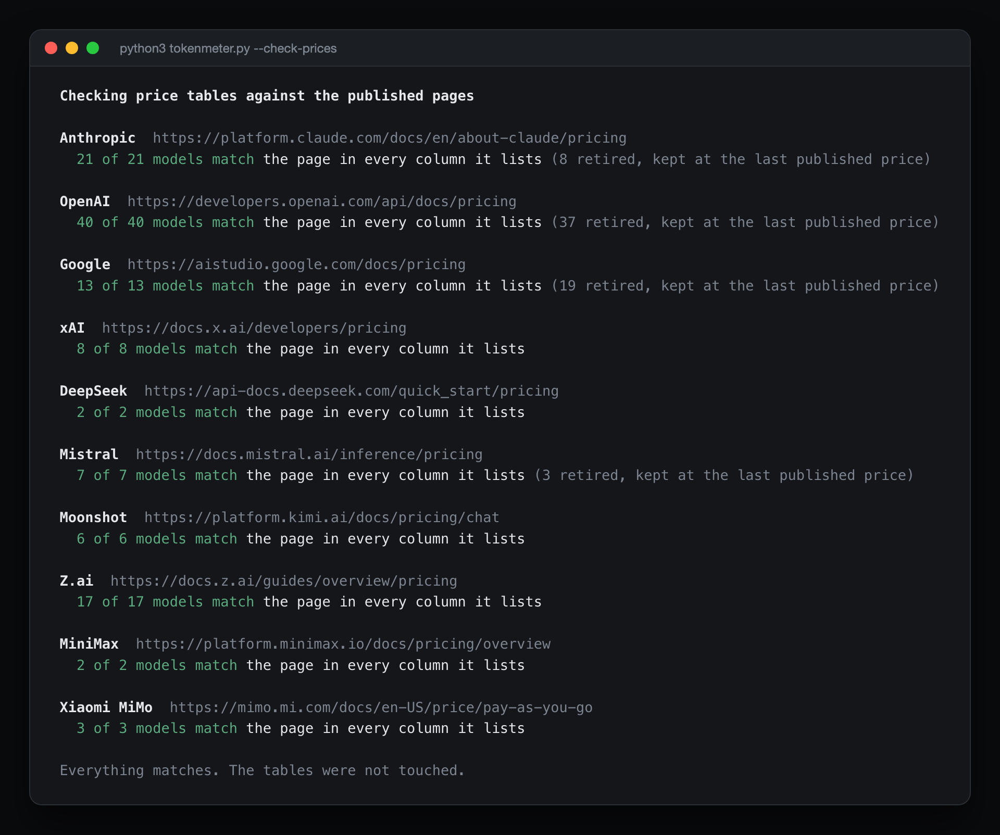
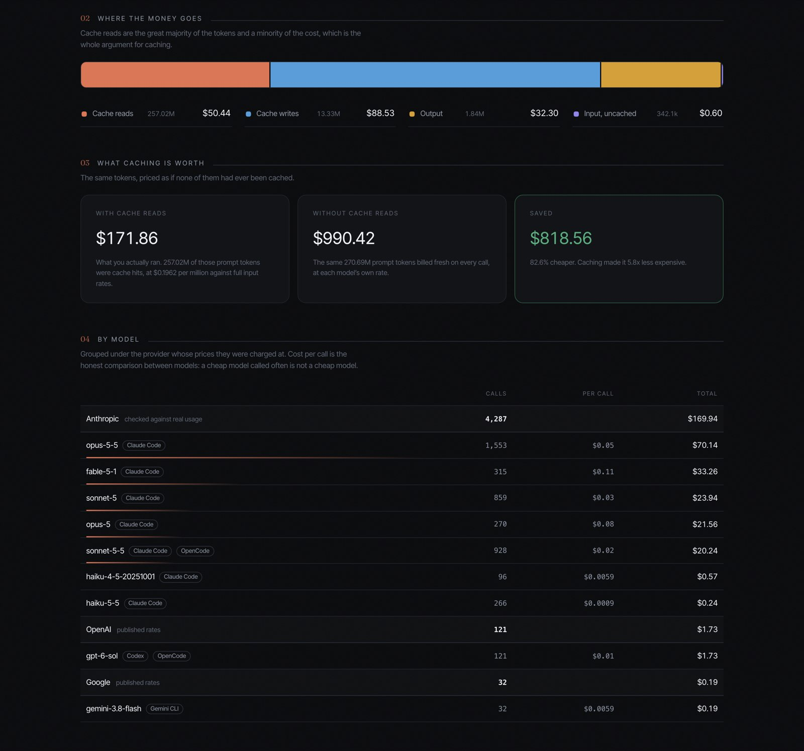

# How accurate is this?

The README's table says which price tables are confirmed, and against what. This page has the rules behind it.

## Where every price comes from

Every price in a table is the one the model's maker publishes on its own site, in US dollars, read on a recorded date: never from memory, a blog or an aggregator such as OpenRouter or LiteLLM. The one other source is an Internet Archive copy of the maker's own pricing page: for a retired model's last price, and for an earlier price of a current model that the live page no longer prints (Mistral Large 4's launch sale and its price from 21 to 31 October 2026), dated from the first capture showing it. Those earlier prices cannot be re-confirmed against the live page. A price published only in another currency is not converted; that model is left out. A retired model keeps its last published price, so older usage is still priced, and the table counts it as retired.

The same rules decide which price a call gets when someone other than the maker served or billed it:

- **An open-weight model** is priced at its maker's rate, whoever served the call. OpenRouter's `moonshotai/kimi-k3` is priced as Moonshot's `kimi-k3`, and `z-ai/glm-4.7-flash` as Z.ai's `glm-4.7-flash`, which Z.ai lists as free.
- **A model billed through a harness's own plan or credits** is priced at its maker's API rate, because the question this tool answers is what the usage would have cost at API rates.
- **A frontier model bought per token through a host** such as OpenRouter keeps the host's price, through the online lookup, labelled as looked up. So does a model whose maker sells no per-token API (gpt-oss, Llama, Gemma, Nemotron).
- **Host and harness spellings** are translated to the maker's id in one place, [`pricing/names.py`](../pricing/names.py), for an exact match of the same model only. An id that cannot be mapped with certainty is priced as recorded, by its table or the lookup. A call prices the same whether it is read fresh or from the ledger.

The tables model what each provider publishes and a log can support: cached input rates, cache writes by lifetime, long-context surcharges above a threshold, fast or priority tiers, dated price changes (Gemini 3.6 to 3.8 Flash rise on 1 January 2027, and each call is priced at the rate on its own day), web searches per 1,000, dated where billing started at a set time (DeepSeek's from 16:00 UTC on 31 October 2026), and DeepSeek's off-peak discount by time of day.

**A model the tables do not have is looked up online at startup,** once: first on the provider's own pricing page where Tokenmeter can read it, otherwise in [LiteLLM's public price list](https://github.com/BerriAI/litellm). The result is saved locally with its source and date, rechecked weekly, and labelled in every report as looked up, not checked by hand. Each provider's pricing page is also read once a day, after a report is written, to check it still agrees with the table (see below). Only price lists and pricing pages are downloaded; no usage data, totals or model names are sent anywhere except the one case of reading an OpenAI model's own page. A lookup that cannot reach its sources is tried again ten minutes later rather than remembered as not found. `TOKENMETER_OFFLINE=1` or `--offline` switches it off, along with the exchange-rate request, and an unknown model is then priced at a flagged stand-in rate.

## What has been checked

**Anthropic rates are verified.** Every rate in the table has been checked against Anthropic's published pricing, and spot-checked against Claude Code's own `total_cost_usd`, which the figures match to ten decimal places. Claude Code is the harness the maintainer uses every day, so these are the numbers that get used and noticed.

**Other providers are best-effort.** Their tables were read from each provider's own pricing pages, figure by figure, and `--check-prices` confirms they still match those pages. What has not been done is comparing them with a real bill from someone who uses those models daily. If you do, please check a month against your invoice and open an issue whether it matches or not.

**Checked prices do not update themselves.** The tables are hand-maintained and each carries the date a person last read every figure off its page, shown in every report, with a warning once it is more than 90 days old. **The live pages are checked once a day.** After a report or the menu bar's run has written its output, Tokenmeter rereads the pricing page of each provider not yet checked that day and compares it with the table, using the same comparison as `tokenmeter --check-prices`. The pages are read side by side, and the whole check gives up after 8 seconds, so a run is held at most once a day, and for no longer than one lookup's timeout. The report's note then adds the day the live page last matched ('live page matched 2 Nov 2026'). If the page differs, the note becomes a warning that names the models whose rates differ, that the page no longer lists, or that it lists and the table lacks, and says to run `--check-prices`. If the page could not be read on two days in a row, the warning says since when; one failed fetch on a bad connection is not taken as evidence that a price moved. The outcome is saved in the price cache, with the looked-up prices. Neither the daily check nor `--check-prices` ever changes a table or its hand-checked date: a rate change is recorded as a new dated entry, so a call is always priced at the rate in force on the day it was made (`--current-rates` prices the whole history at today's rates instead). The status line never fetches, and offline nothing is read. The one price that is fetched and used automatically is for a model no table has, and that is labelled wherever it is used. Exchange rates refresh automatically every 12 hours; the tables' prices do not. Offline, the last saved exchange rate is used at any age and gives its date, and with none saved a built-in estimate is used and labelled as one.

**The 5-minute cache write is measured.** Anthropic's 5-minute cache write multiplier (1.25x) was checked on 19 November 2026 against the per-model cost Claude Code records in its transcripts: 53 sessions that made such writes, on Opus 5.5, Sonnet 5.5, Fable 5.2 and Opus 4.8, 29 of them with no other kind of cache write. With every other component priced from the table, each session's recorded cost gives a multiplier of 1.25 to thirteen decimal places.

**Not modelled, by design:** batch and flex discounts (coding harnesses are interactive), regional or data-residency uplifts, cache storage fees billed by the hour, and search-grounding fees that depend on a monthly free allowance. Qwen has no table because its price depends on region, tier, thinking mode and cache type, which logs do not record; its models are priced by the online lookup and labelled.

