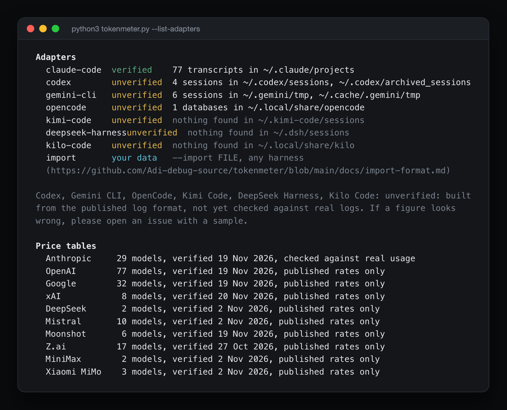
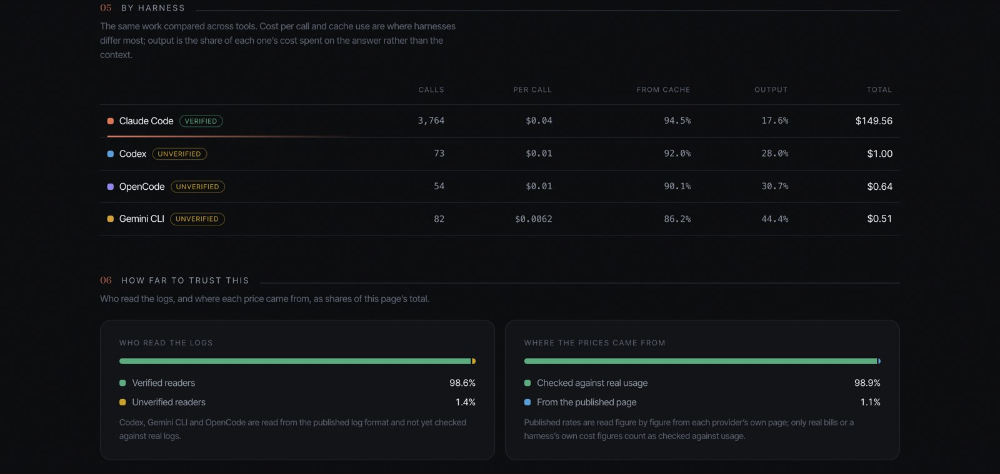

# Supported harnesses

Tokenmeter finds each harness's logs by itself. Each reader carries a verification status, and every report that uses an unverified one says so.

| Harness | Status | What it reads |
|---|---|---|
| Claude Code | **verified** | `~/.claude/projects` (or `$CLAUDE_CONFIG_DIR/projects` when that is an absolute path; any other value is named in a note), subagents and workflow agents included. A `CLAUDE_CONFIG_DIR` set in Claude Code's settings files is not followed |
| OpenAI Codex CLI | unverified | `~/.codex/sessions` and `archived_sessions` (or under `$CODEX_HOME` when that is an absolute path; an empty value counts as unset, and any other is named in a note); the sessions Codex compresses after a week need Python 3.14, the `zstd` command or the `zstandard` package |
| Gemini CLI | unverified | `~/.gemini/tmp/*/chats`, and `~/.cache/.gemini/tmp/*/chats` under the macOS sandbox (or the same two under `$GEMINI_CLI_HOME`, which stands in for the home folder) |
| OpenCode | unverified | `~/.local/share/opencode/opencode*.db` (or under `$XDG_DATA_HOME` when that is an absolute path; an empty value counts as unset, and any other is named in a note) |
| Kilo Code | unverified | `~/.local/share/kilo/kilo*.db` and `opencode-*.db` (or under `$XDG_DATA_HOME` when that is an absolute path, an empty value counting as unset and any other named in a note; or `$KILO_DB`): the extension, the JetBrains plugin and the CLI from 7.0 on. A call from before 7.4.16 whose record does not say whether its output includes reasoning is left out, and the report says how many. Kilo Code 5 and earlier are not read: they record no model |
| Kimi Code | unverified | `~/.kimi-code/sessions` (or `$KIMI_CODE_HOME` when that is an absolute path; any other value is named in a note). A call whose model, cached input or thinking tokens Kimi Code did not record is left out, and the report says how many. The older Python kimi-cli is not read: it records no model |
| DeepSeek Harness | unverified | `~/.dsh/sessions` (or `$DSH_HOME`); compressed sessions (`.jsonl.zstd`, the default) need Python 3.14, the `zstd` command or the `zstandard` package. A call whose usage the harness did not record, a call that wrote to a cache on a route other than DeepSeek's (the write's lifetime is not recorded), and a compaction by another summariser are left out, and the report says how many. So are the calls of subagents it runs in another agent's process: Claude Code and Codex subagents keep no log, so their calls are missing, and the report says how many such runs there were |
| Anything else | your data | `--import FILE`, in the documented format |

**Verified** means checked against real logs and against the harness's own cost figures. Claude Code's figures match its own `total_cost_usd` to ten decimal places.

**Unverified** means built from the harness's published source code and tested against sample files made to that format, but not yet run against real logs. If you use one of these, please compare a figure against your own records and open an issue with a sample either way. One real sample is what it takes to promote an adapter to verified; see [adapters/README.md](../adapters/README.md).



## Several at once

Use more than one harness, or one harness with models from several providers,
and every face adds what comparing them needs. With one of each, nothing
changes.

- **Dashboard:** a Harness menu beside the currencies shows any one harness on
  its own page. The spend chart splits each day by harness, models are grouped
  under the provider that priced them with the harnesses that used each, a
  By harness table compares cost per call and cache use, and 'How far to
  trust this' shows how much of the total came from verified readers and
  from checked prices.
- **Menu bar:** By model stays the default; Break Down By, inside Where
  Today Went, switches it to harnesses or providers.
- **Terminal:** `tokenmeter --by source` compares harnesses side by side.



## Any other harness

Aider, Cline (its CLI and its VS Code extension), Crush, Goose, Hermes Agent, Qwen Code, kimi-cli (the older Python Kimi CLI), Roo Code, Kilo Code 5 and earlier, Zoo Code, Continue, Cursor CLI, GitHub Copilot CLI, Amp, Grok Build and Antigravity have no reader: none of them writes per-call token counts that can be priced exactly, and [adapters/README.md](../adapters/README.md#harnesses-without-a-reader) says what each records and what a reader would need. T3 Code has no reader of its own: its agent turns are counted through the harnesses it drives (Claude Code, Codex, OpenCode and others), but the short calls it makes for thread titles, branch names and commit messages run with logging off and are not counted anywhere, except through Claude Code before 2.0.63, which cannot turn logging off and so keeps them.

For any of these, Cursor, or a script of your own: if you can get at per-call token counts, write one JSON object per call and pass the file with `--import`:

```json
{"id": "resp_01", "timestamp": "2026-09-20T14:03:11Z", "provider": "openai", "model": "gpt-6-sol", "input": 1200, "cache_read": 8000, "output": 350}
```

The format, with a worked example for each provider's conventions, is in [docs/import-format.md](import-format.md). Imported calls go into the ledger like any others, so importing the same file twice counts nothing twice, and they appear in every report, the dashboard and the menu bar.

## What a reader cannot see

- **Side calls with no usable record.** Some harnesses make small extra calls whose usage they keep nowhere, or keep in a form that cannot be priced exactly, so these are not counted:
  - Claude Code's WebSearch calls and some of its WebFetch calls, which it runs through a second, smaller model (Haiku 5.5 in the logs checked) and keeps only in a session's running cost total, the price of each web search with them; on the history this was measured on, 19 November 2026, they came to under 1% of the cost Claude Code recorded;
  - T3 Code's thread titles, branch names, commit messages, pull request text and review guides, which it has Claude Code (2.0.63 or later), Codex or Pi write with session saving off;
  - Gemini CLI's chat compression, its choice of model while the model is left on auto, and its loop checks once a request runs past 30 turns, plus its next speaker check and edit repair when those are turned on;
  - OpenCode's title calls, whose tokens it keeps without the model, and its compaction calls, which it keeps per call without the model, and with the model only as one total over all of them;
  - DeepSeek Harness's Claude Code and Codex subagents, which it runs with session saving off (Claude Code) or in a throwaway thread (Codex); the report says how many subagent runs went to another agent's process;
  - Codex's remote compactions that ran while its settings were changing (after a model switch it compacts on the previous model, or on the new one when that fails), which it keeps per call without the model (the report says how many), and those it runs in the background, which leave no record at all;
  - Kilo Code's title, commit message, branch name and prompt enhancement calls, which it keeps nowhere, and the calls of a compaction split into chunks, whose messages it deletes when each chunk ends; Kilo Code also deletes the record of a call when a message is reverted, a failed reply is cleaned up or a session is deleted, so only calls read before that are counted.
- **A harness folder named relative to where the harness ran.** An empty or relative `CLAUDE_CONFIG_DIR` or `KIMI_CODE_HOME`, a relative `CODEX_HOME`, or a relative `XDG_DATA_HOME` for OpenCode or Kilo Code, or one that still starts with `~` when the harness reads it, points wherever the harness was working; Tokenmeter cannot know that folder, so it reads the default folder instead and says so in the report.
- **Six of seven harness readers are unverified,** as above: only Claude Code's has been checked against real logs.
